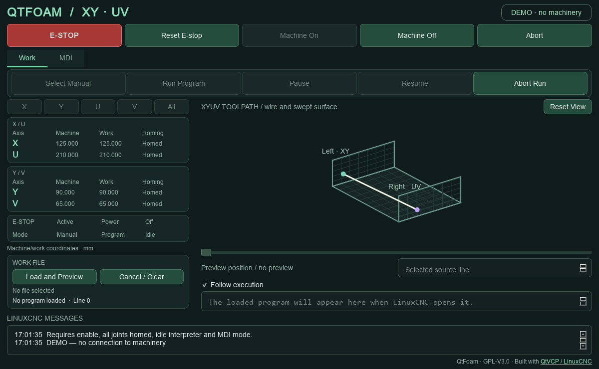
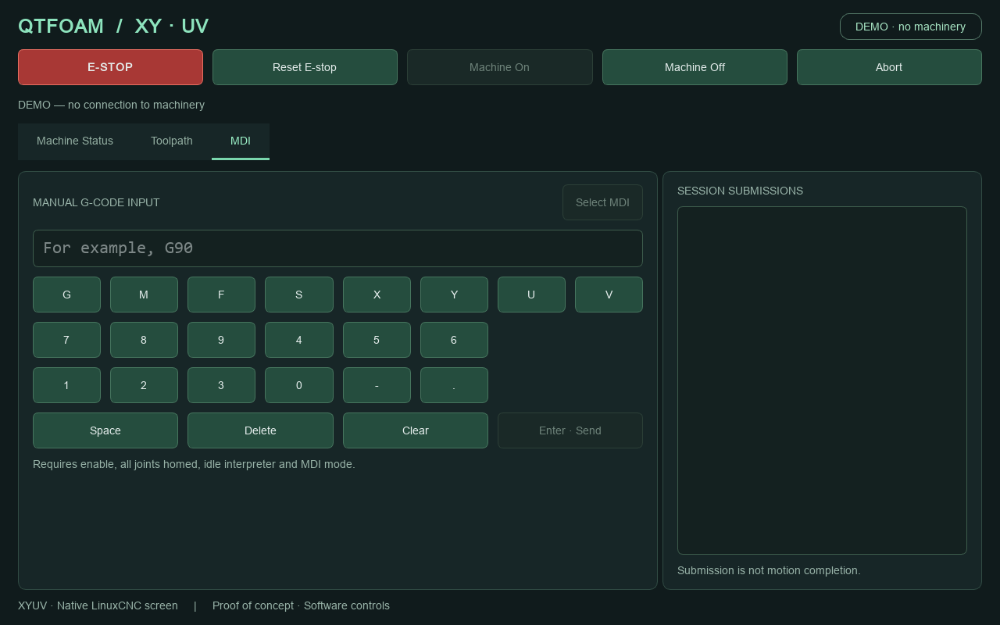

# QtFoam

A native QtVCP screen for a LinuxCNC-controlled XYUV hot-wire foam cutter,
with a dark green interface. QtFoam runs on the
LinuxCNC desktop and replaces AXIS through the machine INI's `DISPLAY` setting.
It does not require Docker, a browser or a network token.
**This tool was created with the help of Codex. If you have an AI allergy, stop reading and head for safer waters.**

## DISCLAIMER — PROOF OF CONCEPT

**Experimental proof-of-concept software. Use entirely at your own risk.**
This software can command real machinery. Configuration errors, defects or
communication failures can cause unexpected motion, fire, equipment damage,
serious injury or death. To the fullest extent permitted by applicable law,
QtFoam is provided **AS IS, WITHOUT WARRANTY**. Authors, copyright holders and
contributors accept no responsibility or liability for consequences of its use.
Nothing here excludes liability that cannot lawfully be excluded; GPLv3 sections
15–17 also apply. Software ESTOP is not a physical safety circuit.

Before using QtFoam, successfully install and configure your own cutter and
verify that it operates correctly with LinuxCNC's standard AXIS interface.
You must be comfortable with Linux terminals, packages, configuration files and
system services. You remain responsible for physical emergency stops, interlocks,
machine configuration and validation on your equipment.

**This project was born purely out of my own selfish need. Feel free to fork it.**
**I won’t necessarily look at pull requests, nor will I provide any support.**

My cutter is built with its origin at the front of the machine and the XV tower
on the left. It uses a [Mesa 7I96S controller](https://store.mesanet.com/index.php?route=product/product&product_id=374&search=96s).

## Installation and commissioning

QtFoam targets LinuxCNC 2.9 with Qt5/PyQt5 QtVCP. Use a working, AXIS-validated
XYUV configuration on a Linux desktop with a compatible real-time kernel.
The commands below use Debian/APT; other distributions need equivalent packages.
Use the same regular account as AXIS, without a Python virtual environment.

### 1. Check dependencies and try the demo

```sh
linuxcnc --help
command -v qtvcp
/usr/bin/python3 -c 'import linuxcnc; from qtvcp.core import Status; from PyQt5 import QtWidgets; print("QtVCP available")'
/usr/bin/python3 -c 'import gcode; from rs274.interpret import Translated, StatMixin; print("Preview modules available")'
```

QtVCP and the preview interpreter come from LinuxCNC, not pip. If needed, install
these packages using your existing LinuxCNC APT repository:

```sh
sudo apt-get update
sudo apt-get install linuxcnc-uspace python3-pyqt5 python3-pyqt5.qtopengl \
  python3-pyqt5.qtsvg python3-pyqt5.qsci python3-opengl
qtvcp --help
```

Keep your working LinuxCNC installation and RT kernel. See the
[QtVCP guide](https://linuxcnc.org/docs/2.9/html/gui/qtvcp.html) for platform requirements.

Clone or copy QtFoam to, for example, `~/git/qtfoam`, then try the layout:

```sh
cd ~/git/qtfoam
python3 demo.py
```

The **DEMO · no machinery** mode never connects to LinuxCNC or hardware. Enable,
homing and run controls simulate states only; MDI is recorded but not interpreted.
Runs do not advance or finish automatically; use Abort. Demo preview uses a
limited geometry parser and is not LinuxCNC program validation.

### 2. Install a separate QtFoam configuration

With the machine idle, stop any automatic launcher and close LinuxCNC. Keep the
working AXIS INI and copy it **within the same configuration directory** so HAL
and parameter paths remain valid. Adjust the example names to your machine:

```sh
cd ~/linuxcnc/configs/foamcutter
cp foamcutter.ini foamcutter-qtfoam.ini
cd ~/git/qtfoam
python3 deploy/install_screen.py --config-dir "$HOME/linuxcnc/configs/foamcutter"
```

The installer copies the UI, handler, theme and `qtfoam/` package, backing up
existing QtFoam files. It does not edit INI/HAL or overwrite AXIS. Run without sudo.
In the copied INI, edit the existing `[DISPLAY]` section:

```ini
[DISPLAY]
DISPLAY = qtvcp -m qtfoam

[QTFOAM]
WIRE_SPAN = 1000
```

`-m` maximizes the window; `-f` selects fullscreen. Keep all machine, kinematics,
homing and limit settings. Adapt or omit AXIS-specific panels and `POSTGUI_HALFILE`
references to `axisui.*`, `pyvcp.*` or other AXIS-created pins. QtFoam exports no
custom HAL control pins. Preserve physical interlocks and machine HAL wiring.

Exactly four joints are required: 0/1/2/3 map to X/Y/U/V (coordinate indices
0/1/6/7). X/Y are the left endpoint's horizontal/vertical axes; U/V are the right.
Homing order, synchronized homing and travel limits remain LinuxCNC settings.

Visualization reads each axis's `MIN_LIMIT` and `MAX_LIMIT` from its existing
`[AXIS_X]`, `[AXIS_Y]`, `[AXIS_U]` or `[AXIS_V]` section. Negative and unequal
ranges are supported. `WIRE_SPAN` is the distance between the XY and UV guides,
not stock width or slanted wire length. Use configured machine units for all
values; display geometry is converted to millimetres. Restart after INI changes.
Invalid geometry leaves the view empty with an explanation in **LinuxCNC messages**;
machine controls remain available. Demo geometry is X/U 0–710 mm, Y/V 0–260 mm,
with a 1000 mm span.

### 3. Start and verify

Power on the controller and launch the copied INI:

```sh
linuxcnc "$HOME/linuxcnc/configs/foamcutter/foamcutter-qtfoam.ini"
```

Run one LinuxCNC instance at a time. Before cutting:

1. Verify XYUV mapping, units, coordinate readings and configured visualization.
2. Check physical E-stop/interlocks, enable controls and homing on your machine.
   Homing selects joint mode; LinuxCNC controls the actual movement and sequence.
3. Check the home/positive-limit feedback described under Work below.
4. With enable and homing complete, select MDI mode and test a non-motion command
   such as `G90` before motion commands.
5. Preview a known program, check its starting position and offsets, and validate
   program operation on your equipment before cutting.

Status is polled every 200 ms. Commands are never automatically retried or
replayed. Uncertain command completion blocks ordinary commands until Abort;
ESTOP, Machine Off and Abort remain available while commands are pending.
Closing the DISPLAY ends the LinuxCNC session. Launch the original INI to use AXIS.

For updates, close LinuxCNC while idle, rerun the same installer command and
restart the copied INI. The installed screen is a copy; editing the checkout
alone does not update it.

### Development tests

Run from the project root:

```sh
python3 -m unittest discover -s tests -v
QT_QPA_PLATFORM=offscreen python3 -m unittest discover -s tests -p test_screen.py -v
```

Tests use fake machines, mocked interpreter callbacks and demo subprocesses;
they never command hardware. Live interpreter and Mesa integration require
Debian-host testing. Qt Designer is optional: the `.ui` is a small shell, with
shared widgets composed in `qtfoam/screen.py`. To edit it:

```sh
sudo apt-get install qttools5-dev-tools qttools5-dev libpython3-dev
designer qtfoam.ui
```

See the [QtVCP Designer setup](https://linuxcnc.org/docs/2.9/html/gui/qtvcp.html#_get_qt_designer_to_include_linuxcnc_widgets)
when adding LinuxCNC-specific widgets.

## Work tab

Work combines homing, coordinates, file preview and program execution. The left
sidebar contains X/Y/U/V/All homing, machine/work coordinates, machine state and
**Work file**. The main area contains the toolpath, preview slider and read-only
G-code listing, with run controls above. ESTOP, Reset E-stop, Machine On/Off,
Abort and **LinuxCNC messages** are shared with MDI. Messages include application
status, preview results and errors without duplicating repeated poll results.



### Homing and limit feedback

HAL signals `joint-0-home` through `joint-3-home` show green **Homed** while
active; normal homed/homing text returns when released. This switch feedback
does not change LinuxCNC's actual homed state.

`pos-limit-joint-0` through `pos-limit-joint-3` latch red **Halted** on the affected
axes and request E-stop. The latch takes priority over home feedback and survives
switch release or status loss. Reset E-stop clears it only when all four signals
are readable and false; missing signals are unknown. No extra INI inversion is
applied. Monitoring uses the 200 ms UI poll: retain HAL limit/E-stop interlocks
for real-time protection and shorter pulses.

### Load and inspect G-code

Select **Load and Preview** under **Work file** and choose a UTF-8 `.nc` or `.ngc`
file. `examples/xyuv-preview.ngc` and `examples/devwing-preview.nc` (G93) are
preview fixtures, not commissioned machine programs. Preview requires an idle
interpreter with no homing, paused program or pending command; enable and homing
are not required. Loading a preview neither opens a LinuxCNC program nor starts it.

Interpretation runs in a separate process. Ordinary controls are disabled while
it runs; ESTOP, Off, Abort and **Cancel / Clear** cancel it. Closing the screen
also terminates the worker. Loading another file clears the previous preview.

- XY paths are blue, UV purple, feed surfaces translucent and G0 paths dashed
  orange without a cut surface. A table grid joins the guide planes at the lowest
  Y/V limit.
- The gold wire follows the slider from the captured starting position; hover
  over the slider for the original source line and G-code. The white wire shows
  sampled machine position. The slider does not command motion or follow execution.
- Left drag rotates around the base plane, right drag tilts without flipping,
  wheel zooms at the pointer, middle drag zooms (up=in), and Shift + left drag
  pans. **Reset View** restores orientation, zoom and position. Initial framing
  fits the preview without clamping it to the machine envelope.

Wire sag, stretch, tension and heater state are not modeled. Display bounds do
not enforce limits. For non-mm machines the live wire is hidden; preview geometry
uses millimetres and coordinate readings use machine units.

### Preview support and limits

Live preview uses LinuxCNC's `gcode.parse` / `rs274` interpreter for G0/G1 XYUV,
including G93 inverse-time feed (which changes timing, not geometry). It captures
position, WCS/G92 offsets, XY rotation and units; a position, offset or machine
state change during interpretation discards the result. Re-preview after changing
the intended start or offsets.

A private source copy initializes units, G90/G94/G17/G40/G49 and the active WCS,
normalizes percent delimiters and appends M2. Source mapping excludes the added
initialization line. The real parameter file is never modified. Preview executes
no machine commands or physical M-code effects; M0 does not pause interpretation.
Temporary source/parameter copies are removed on completion, error or cancellation.

Limits are **256 KiB per file, 12,000 motion segments, 20 seconds and 8 MiB worker
output**. Any interpretation error discards the entire result.

Unsupported: G2/G3 arcs, probing, rigid tapping, other axes, nonzero tool offsets
and RS274NGC REMAP configurations. Machine-specific INI startup code and external
subroutine search paths are not simulated; inactive WCS offsets read from disk
may be stale. Preview does not validate travel limits, heater state or cut suitability.

Demo preview supports only G0/G1, G20/G21, G90/G91, G17, G93/G94, comments and
common M codes with no physical effects. It rejects macros, expressions and WCS
changes and is never a fallback for failed live interpretation.

### Run, pause and stop

1. Enable the machine, home all four joints and leave the interpreter idle.
2. Load and inspect the program. Re-preview if the start or coordinate context changed.
3. Press **Run Program**. QtFoam selects AUTO, opens the prepared copy and starts
   from the beginning, waiting for acknowledgement at each stage. Preparation
   steps time out after five seconds; commands are not retried.
4. **Pause** and **Resume** control a run started by this session, including M0
   pauses. **Abort Run** and the shared Abort stop activity through LinuxCNC.

Run requires no ESTOP, pause, homing or manual command; the position must match
within 0.001 machine units, offsets within 1e-6, and rotation, units and INI path
must remain unchanged. The prepared file's SHA-256 is checked at each preparation
stage. All preview restrictions apply, including the REMAP exclusion.

The exact normalized preview source is stored with private permissions under
`~/.local/share/qtfoam/programs/`. Run opens this copy, so later edits to the
original cannot replace it. Start permission is consumed before AUTO_RUN, even
if its response is uncertain: preview again after completion or Abort. Closing
QtFoam also loses that permission. Loading/clearing, status loss, ESTOP, Off,
Abort or another manual command cancels preparation without replaying a start.
The loaded/running copy is retained during cleanup; unneeded older copies may
be removed while idle.

Ordinary controls are disabled during preparation, while safety controls remain
available. Execution happens in LinuxCNC and can move machinery and operate the
heater through configured M codes and HAL wiring.

### Execution listing

The read-only listing below the slider shows the file actually loaded in LinuxCNC,
with physical file line numbers and execution highlighting. **Follow execution**
automatically scrolls; disable it to browse while highlighting continues. Updates
use the 200 ms poll, so short moves may pass between samples.

The listing includes the added initialization line and M2; its line numbers differ
from the original source and from G-code `N` words. Program status reports the
original source line with initialization removed. Pause retains highlighting;
completion, Abort, leaving AUTO or status loss clears it. Unreadable files report
an error without disabling controls. Demo shows prepared text without execution
progress. Automatic execution tracking in the 3D view and jogging are not implemented.

## MDI tab

MDI provides live X/Y/U/V work coordinates, a one-line command input, touch
keyboard, heater controls, four persistent macros and session submission history.
Select **MDI** mode explicitly. Sending requires machine enable, all joints homed
and an idle interpreter. Commands can move the machine and execute configured
M codes; validation and status appear in **LinuxCNC messages**.



### Commands, macros and heater

Type a single G-code line and press **Enter / Send**. Double-click a session
submission to recall it for editing. **Edit macros** sets four button names and
single-line commands, saved per user (demo settings are separate). A macro loads
the input for review and Enter submission; blank macros are disabled.

**Heater On · M8** and **Heater Off · M9** submit immediately when MDI is available,
retain draft input and appear in Session Submissions. Their physical effect
depends on the machine's HAL/M-code configuration.

### Touch keyboard and paired-axis shortcuts

Letter keys are grouped as `G M`, `X Y`, `U V`, `F S`, beside a standard numeric
keypad (`7–9`, `4–6`, `1–3`, then `- 0 .`). Space, Delete, Clear and Enter/Send
sit below. Editing respects the cursor/selection; editing and Send are disabled
when MDI is unavailable. Keyboard Enter uses the same validation.

Enter `<target>XU` or `<target>YV` to generate an absolute rapid move for both
axes in the pair, in millimetres:

| Input | First Enter: load for review | Second Enter |
| --- | --- | --- |
| `400XU` | `G21 G90 G0 X400 U400` | Execute the reviewed command |
| `50YV` | `G21 G90 G0 Y50 V50` | Execute the reviewed command |

Targets are work coordinates, not increments; choose values within the machine's
working range. Lowercase, negative values and decimal points/commas are accepted
(e.g. `-10xu`, `125.5XU`, `125,5XU`). G21 and G90 remain active afterward, and G0
uses rapid motion rather than cutting feed. History records the actual G-code.

## License

GNU General Public License version 3 only (`GPL-3.0-only`), see [LICENSE](LICENSE).
The screen installer preserves the license and acknowledgements as
`qtfoam.LICENSE` and `qtfoam.NOTICE.txt` in the machine configuration directory.
Existing copies are backed up with the screen; a configuration's own `LICENSE`
file is left untouched. See [NOTICE.txt](NOTICE.txt) for dependency acknowledgements.
The footer on every tab links to the official QtVCP / LinuxCNC documentation.
Design and coordinate-mapping approach derived from Foamomatic; third-party
components retain their own licenses.
