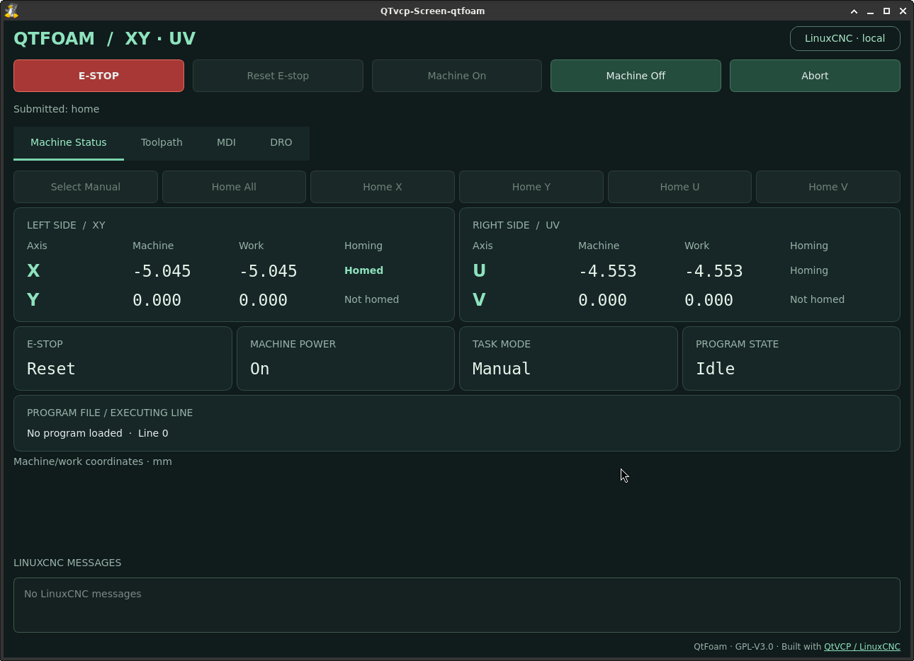
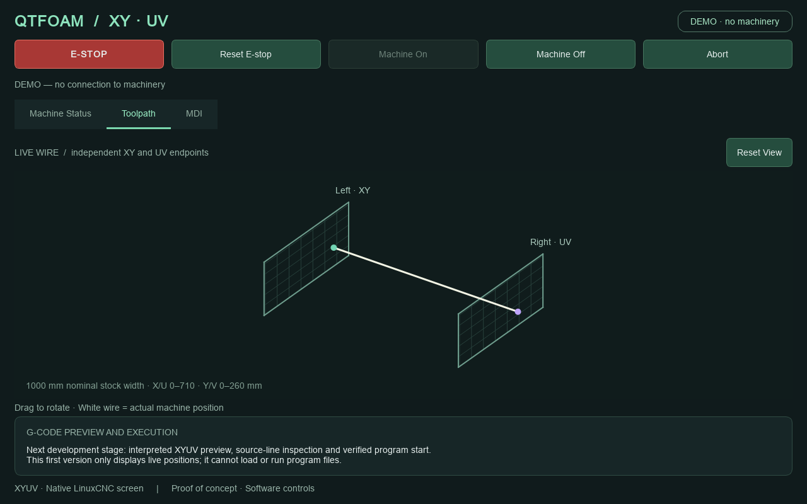

# QtFoam

A native QtVCP screen for a LinuxCNC-controlled XYUV hot-wire foam cutter,
with the dark green layout and workflow of Foamomatic. QtFoam runs on the
LinuxCNC desktop and replaces AXIS through the machine INI's `DISPLAY` setting.
It does not require Docker, a browser, a network token or the Foamomatic adapter.
This tool was created with the help of Codex.

## DISCLAIMER — PROOF OF CONCEPT

**Experimental proof-of-concept software. Use entirely at your own risk.**
This software can command real machinery. Configuration errors, defects or
communication failures can cause unexpected motion, fire, equipment damage,
serious injury or death. To the fullest extent permitted by applicable law,
QtFoam is provided **AS IS, WITHOUT WARRANTY**. Authors, copyright holders and
contributors accept no responsibility or liability for consequences of its use.
Nothing here excludes liability that cannot lawfully be excluded; GPLv3 sections
15–17 also apply. Software ESTOP is not a physical safety circuit.

Before using QtFoam, successfully install and configure your own cutter and
verify that it operates correctly with LinuxCNC's standard AXIS interface.
You must be comfortable with Linux terminals, packages, configuration files and
system services. You remain responsible for physical emergency stops, interlocks,
machine configuration and validation on your equipment.

## Current features

- Always-visible ESTOP, Reset E-stop, Machine On/Off and Abort controls.
- Machine Status: separate XY and UV machine/work coordinates, individual joint
  homing and Home All, operating mode, power, homing state and executing line.
- Toolpath: native, draggable QPainter XYUV view with live wire position,
  G-code file selection, endpoint paths, swept surfaces and a source-line slider.
  Preview uses LinuxCNC's interpreter in a separate, time-limited process.
- Run Program, Pause, Resume and Abort Run: execute the prepared copy that was
  previewed, with acknowledged AUTO/open/start sequencing and no automatic retry.
- MDI: explicit mode selection, one-line submission, touch keyboard and session
  history with double-click recall. Four named, persistent macros load a command
  into the input for review and Enter submission. Commands require enable, all
  joints homed and an idle interpreter.
- Dedicated Heater On (M8) and Heater Off (M9) buttons on the MDI tab.
- An always-visible LinuxCNC message history with timestamps and message types.
- Toolpath geometry from INI axis limits and the configurable wire-guide span.
- A hardware-disconnected demo for layout development.

**Not implemented yet:** automatic visual execution-progress tracking and jogging.
Loading a file for preview does not open it in
LinuxCNC or start a program; Run Program is a separate explicit action. Program
execution and MDI can move the machine and execute M codes according to its
INI/HAL configuration.

Left endpoint: X horizontal, Y vertical. Right endpoint: U horizontal, V vertical.
Coordinate indices are 0/1/6/7; joints must be 0/1/2/3 in X/Y/U/V order. The first
version requires exactly these four axes/joints. Homing sequencing and travel
limits remain LinuxCNC INI/HAL settings.

Visualization reads `MIN_LIMIT` and `MAX_LIMIT` separately from `[AXIS_X]`,
`[AXIS_Y]`, `[AXIS_U]` and `[AXIS_V]` in the active LinuxCNC INI. Negative limits
and different travel ranges on the two sides are supported. Add the distance
between the XY and UV wire guides to that same INI:

```ini
[QTFOAM]
WIRE_SPAN = 1000
```

`WIRE_SPAN` is the guide separation, not the stock width or the length of a
slanted wire. Use the machine's configured linear units for this value and the
axis limits; QtFoam converts display geometry to millimetres. For example, an
existing axis section may contain:

```ini
[AXIS_X]
MIN_LIMIT = 0
MAX_LIMIT = 710
```

Keep each axis's actual limits in its own existing section. Geometry is read
when the screen connects; restart LinuxCNC after changing the INI. Missing,
non-finite or invalid values show an explanation in the Toolpath view without
disabling machine controls. The disconnected demo alone uses X/U 0–710 mm,
Y/V 0–260 mm and a 1000 mm guide span.

Wire sag, stretch, tension and heater state are not modeled. Display bounds do
not enforce travel limits, and positions are not clamped. For non-mm machines,
the live wire remains hidden; preview geometry is in millimetres and coordinate
readings use the configured machine units.



## Debian / LinuxCNC installation

### 1. Verify LinuxCNC and QtVCP

Use the Debian LinuxCNC computer, with its working real-time kernel and validated
XYUV configuration. Use the same regular account as AXIS, in a graphical desktop
terminal. Do not install QtFoam in a virtual environment: the live screen needs
the distribution's LinuxCNC and QtVCP Python modules.

```sh
linuxcnc --help
command -v qtvcp
/usr/bin/python3 -c 'import linuxcnc; from qtvcp.core import Status; from PyQt5 import QtWidgets; print("QtVCP available")'
```

QtVCP is supplied with LinuxCNC. If the `qtvcp` command is missing, use your
existing LinuxCNC APT repository to install the desktop package:

```sh
sudo apt-get update
sudo apt-get install linuxcnc-uspace
```

This assumes the LinuxCNC repository is already configured; do not replace a
working LinuxCNC installation or its real-time kernel just to try this screen.
Install the Qt runtime packages if they are missing:

```sh
sudo apt-get install python3-pyqt5 python3-pyqt5.qtopengl \
  python3-pyqt5.qtsvg python3-pyqt5.qsci python3-opengl
qtvcp --help
```

This project targets the Qt5/PyQt5 QtVCP shipped with LinuxCNC 2.9. Read the
[official QtVCP guide](https://linuxcnc.org/docs/2.9/html/gui/qtvcp.html)
for the screen-loading mechanism and platform requirements.

### 2. Try the disconnected demo

Copy or clone this project to a directory such as `~/git/qtfoam`. From its root:

```sh
python3 demo.py
```

The demo imports no LinuxCNC API and never connects to machinery. It displays a
persistent **DEMO · no machinery** badge. Reset E-stop, Machine On, homing and
MDI change only its in-memory simulation. MDI text is validated and recorded but
not interpreted. Run/Pause/Resume/Abort simulate control states only, without
moving endpoints, executing M codes or automatically reaching the end of a file;
use Abort to finish a demo run. File preview uses a separate, limited geometry-only parser;
it is visibly marked DEMO and is not LinuxCNC program validation. Use this mode
first to evaluate layout and touch input.

### 3. Make a separate INI for QtFoam

With the machine idle, stop any automatic LinuxCNC launcher and close LinuxCNC.
If using Foamomatic's optional desktop launcher:

```sh
systemctl --user stop foamomatic-linuxcnc
```

Keep your working AXIS INI. Create a second INI **in the same configuration
directory**, preserving all existing HAL/parameter paths:

```sh
cd ~/linuxcnc/configs/foamcutter
cp foamcutter.ini foamcutter-qtfoam.ini
```

Adjust these example names to your machine. Install the screen files into that
configuration directory from the QtFoam checkout:

```sh
cd ~/git/qtfoam
python3 deploy/install_screen.py --config-dir "$HOME/linuxcnc/configs/foamcutter"
```

The installer copies `qtfoam.ui`, `qtfoam_handler.py`, `qtfoam.qss` and the
`qtfoam/` Python package. Existing QtFoam files are backed up before an update.
It never edits INI/HAL or overwrites the AXIS screen. Run it as the regular user,
without sudo.

In **foamcutter-qtfoam.ini**, replace the `DISPLAY` entry under `[DISPLAY]`:

```ini
[DISPLAY]
DISPLAY = qtvcp -m qtfoam
```

Edit the existing section; do not add a second `[DISPLAY]` section. Retain your
machine's other INI sections, kinematics, axes, joints, limits and homing settings.
`-m` maximizes the window; use `-f` instead for fullscreen.

Review AXIS-specific `PYVCP`, embedded panels and `POSTGUI_HALFILE` settings in
the copied INI. Any HAL references to `axisui.*`, `pyvcp.*` or other AXIS-created
pins must be adapted or omitted for the new screen. QtFoam currently exports no
custom HAL control pins. Do not remove physical interlocks or machine HAL wiring.

### 4. Start the QtFoam configuration

Power on the controller, then launch the copied INI from the desktop terminal:

```sh
linuxcnc "$HOME/linuxcnc/configs/foamcutter/foamcutter-qtfoam.ini"
```

Run only one LinuxCNC instance at a time. The native screen polls local status
at 5 Hz. Check XYUV coordinate mapping, units and homing indicators before using
controls. Test non-motion MDI such as `G90` first, after enable/homing and explicit
MDI mode selection. Commands are not automatically retried or replayed.

Homing explicitly selects joint mode before submitting the selected joint;
actual movement and synchronized homing restrictions come from LinuxCNC.
An uncertain command completion blocks further ordinary commands until Abort.
ESTOP, Off and Abort remain available while a command is pending.

Closing a QtVCP screen configured as `DISPLAY` ends that LinuxCNC session. To
return to AXIS, close LinuxCNC and launch the original INI.

### 5. Keep automatic startup separate for now

Foamomatic's current Mesa-triggered launcher uses `axis-remote --quit` for graceful
shutdown. It has **not** been adapted to close QtFoam. Leave that launcher stopped
while testing this project, and keep its INI pointing to your AXIS configuration.
Do not change its INI to QtFoam yet. A later integration should give QtFoam its
own controlled shutdown path before enabling controller power-cycle recovery.

Foamomatic can remain installed. Its web UI and QtFoam can both send commands to
the same LinuxCNC runtime; this version does not arbitrate ownership across UIs.
Use one operator interface at a time during validation.

## G-code preview

The MDI tab has four configurable macro buttons. **Edit macros** sets each
button's name and single G-code line; settings persist for the current user
(demo settings are separate). Clicking a macro replaces the input line;
review or edit it and press Enter to send. A blank macro is disabled.
**Heater On · M8** and **Heater Off · M9** submit immediately when MDI is
available, retain any draft input, and appear in Session Submissions.

Open **Toolpath**, press **Load and Preview**, and select a UTF-8 `.nc` or `.ngc`
file. Try `examples/xyuv-preview.ngc` for a visible shape or
`examples/devwing-preview.nc` for a Devwing G93 sample. These are preview fixtures,
not commissioned machine programs.

The live screen requires LinuxCNC to be idle, with no homing, paused program or
pending command. Machine enable and homing are not required just to preview.
The interpreter runs in a separate process so the Qt event loop remains active.
Ordinary machine controls are disabled during interpretation; ESTOP, Off and
Abort remain available and cancel the preview. **Cancel / Clear** also stops the
worker. Closing the screen terminates an outstanding preview process.

- XY endpoint paths are blue and UV paths purple; feed moves have translucent
  swept surfaces. G0 paths are dashed orange and have no cut surface.
- The gold wire follows the preview slider, starting at the captured machine
  position. The white wire continues to show actual sampled machine position.
- The slider identifies each motion's original source line and displays its text.
  It does not move the machine or follow program execution in this version.
- Drag to rotate and use **Reset View** to restore the angle. The view fits the
  preview bounds without clamping coordinates to the nominal machine envelope.



### Interpretation and limits

Live preview uses LinuxCNC's `gcode.parse` / `rs274` modules supplied by the host
installation, using the same read-only interpretation approach as Foamomatic.
They are not installed with pip. Check availability with:

```sh
/usr/bin/python3 -c 'import gcode; from rs274.interpret import Translated, StatMixin; print("Preview modules available")'
```

G0/G1 XYUV paths and G93 inverse-time feed programs are supported. G93 changes
motion timing, not endpoint geometry. The initial position, active WCS/G92
offsets, XY rotation and machine units are captured before interpretation.
A changed position, offsets or machine state during interpretation discards the
result. Preview geometry is expressed in millimetres in the machine frame.

Preview initializes units, G90/G94/G17/G40/G49 and the captured active WCS in a
private source copy. Percent delimiters are normalized and M2 is appended;
source-line mapping excludes the added initialization line. Small homing
roundoff values use decimal notation, avoiding scientific-notation E-word errors.

Files are limited to 256 KiB, previews to 12,000 motion segments, interpreter
runtime to 20 seconds and worker output to 8 MiB. Interpretation errors discard
the entire result; an older preview is cleared before loading another file.
Temporary source and parameter copies are owned by the parent job and removed
after completion, failure or cancellation. The real LinuxCNC parameter file is
never modified. No `linuxcnc.command`, HAL commands or machine M codes are
executed by the preview worker; M0 does not pause preview interpretation.

Arcs (G2/G3), probing, rigid tapping, motion on other axes and nonzero tool offsets
are unsupported. Configurations with RS274NGC REMAP are rejected. Machine-specific
INI startup code and external subroutine search paths are not simulated. Inactive
WCS offsets come from the on-disk parameter file and may be stale. Preview does
not validate travel limits, heater state or whether a cut is physically suitable.
Re-preview after changing the intended starting position or offsets.

Demo preview supports a deliberately smaller subset: G0/G1, G20/G21, G90/G91,
G17, G93/G94, comments and common M codes whose physical effects are ignored.
Macros, expressions and WCS changes require the live interpreter and are rejected
in the demo. The demo parser is never used as a fallback for failed live preview.

To deploy this update, with the machine idle, close LinuxCNC and rerun the screen
installer for your separate QtFoam configuration directory, then launch its INI:

```sh
python3 deploy/install_screen.py --config-dir "$HOME/linuxcnc/configs/foamcutter-qtfoam"
linuxcnc "$HOME/linuxcnc/configs/foamcutter-qtfoam/foamcutter-qtfoam.ini"
```

Replace both paths with your actual copied configuration. No new pip packages,
Docker rebuild or Foamomatic service restart is needed.

## Run the previewed program

1. Enable the machine, home all four joints and leave the interpreter idle.
2. Load and inspect the intended program in **Toolpath**. Preview again if the
   starting position, work offsets or active coordinate system changed.
3. Press **Run Program**. QtFoam selects AUTO mode, waits for acknowledgement,
   opens the prepared copy, waits for acknowledgement and its loaded path, then
   submits AUTO_RUN from the beginning. Each preparation step has a five-second
   timeout. No command is automatically retried.
4. Use **Pause** to request a program pause and **Resume** to continue, including
   after M0. These controls address only a program started by this QtFoam session.
   **Abort Run** and the header Abort stop machine activity through LinuxCNC.

Run requires machine enable, no ESTOP, all joints homed, idle interpreter, no
pause/homing/manual command, unchanged starting position (0.001 machine-unit
tolerance), work/tool offsets (1e-6), rotation, units and INI path. The prepared
file's SHA-256 is checked before each preparation stage. Configurations with
RS274NGC REMAP remain unsupported. All preview limitations still apply.

QtFoam stores the exact normalized source interpreted by preview under
`~/.local/share/qtfoam/programs/` using a unique filename and private permissions.
It does not execute the user's original file path, so later edits to that file
cannot replace the previewed copy. Preview itself still issues no machine commands.
The prepared file is opened only after the user presses Run Program.

Start authority is consumed **before** AUTO_RUN is issued, even if its response
is uncertain. Preview again for another run after completion or Abort. Closing
QtFoam loses start authority. Loading/clearing a preview, status loss, ESTOP, Off,
Abort or another manual command cancels pending preparation. They never replay
or resume an earlier start. A consumed copy cannot be started again from that
preview. The file currently loaded/running is retained when old copies are pruned;
files left by earlier application sessions may be removed while idle if unneeded.

During preparation ordinary controls are disabled; safety controls remain usable.
During execution the program runs locally in LinuxCNC, including real M-code and
heater wiring. Program status displays the executing source line with the added
initialization line removed. The slider remains for manual inspection; automatic
visual following is a later feature. Closing the native DISPLAY ends the LinuxCNC
session, as described in installation.

### MDI touch keyboard


Letters are grouped to the left (`G M`, `X Y`, `U V`, `F S`). The numeric keypad
has the standard arrangement:

```text
7 8 9
4 5 6
1 2 3
- 0 .
```

Space, Delete, Clear and Enter/Send remain below the keys. Insertion and deletion
follow the command field's cursor/selection. Editing keys and Send are disabled
when MDI commands are unavailable; Enter uses the same command validation.

## Development

```text
qtfoam.ui                 QtVCP/Qt Designer window shell
qtfoam_handler.py         QtVCP lifecycle integration
qtfoam.qss                Foamomatic-inspired native Qt theme
qtfoam/screen.py           Native widgets, tabs and touch keyboard
qtfoam/wire.py             Cached QPainter paths, swept surfaces and live wire
qtfoam/preview.py          Source/context preparation and result validation
qtfoam/preview_job.py      Asynchronous QProcess, timeout and cancellation
qtfoam/preview_worker.py   Isolated LinuxCNC RS274 interpreter callbacks
qtfoam/demo_preview.py     Limited hardware-disconnected geometry parser
qtfoam/programs.py         Preview-bound prepared files and acknowledged AUTO sequence
qtfoam/backend.py          Local LinuxCNC API and isolated demo backend
qtfoam/model.py            Coordinate mapping and control permissions
```

The `.ui` file is deliberately a small Qt Designer shell; the first iteration's
widgets are composed in Python so they can be shared with the disconnected demo.
Qt Designer is optional for running the screen. To edit the shell:

```sh
sudo apt-get install qttools5-dev-tools qttools5-dev libpython3-dev
designer qtfoam.ui
```

Custom QtVCP Designer widgets are not required by this version. Follow the
[official Designer setup](https://linuxcnc.org/docs/2.9/html/gui/qtvcp.html#_get_qt_designer_to_include_linuxcnc_widgets)
if adding LinuxCNC-specific widgets later.

After code changes, close LinuxCNC while idle, rerun `deploy/install_screen.py`,
and start the copied INI again. The installed screen is a copy of the checkout,
so editing the checkout alone does not update the machine configuration.

Run tests from the project root:

```sh
python3 -m unittest discover -s tests -v
QT_QPA_PLATFORM=offscreen python3 -m unittest discover -s tests -p test_screen.py -v
```

Tests use fake machine objects, mocked LinuxCNC interpreter callbacks and real
preview subprocesses in demo mode. They never command real hardware. Actual
LinuxCNC interpreter integration and Mesa operation require Debian-host testing.

Next development stages: add automatic visual execution-progress tracking, then integrate
desktop startup/shutdown with the Mesa supervisor. The two
repositories are independent; this version does not import from a sibling checkout.

## License

GNU General Public License version 3 only (`GPL-3.0-only`), see [LICENSE](LICENSE).
Design and coordinate-mapping approach derived from Foamomatic; third-party
components retain their own licenses.
